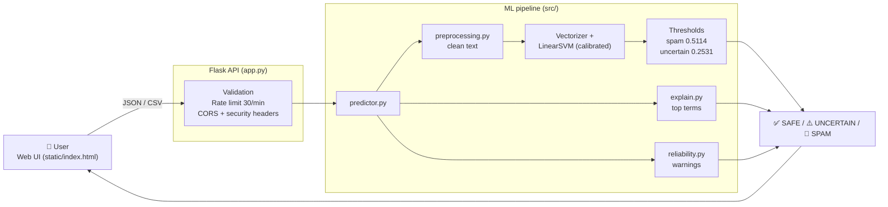
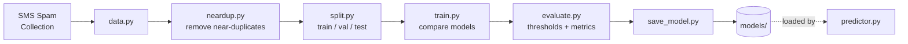

<div align="center">

# 🛡️ MailGuard AI

### Explainable spam & phishing email detector


</div>

---

## 📌 At a glance

| Problem | Data | Methods | Libs | Link |
|:---|:---|:---|:---|:---|
| Classify a message as **spam, safe or uncertain** and explain the decision | SMS Spam Collection (labelled `ham` / `spam`) | Text cleaning, near-duplicate removal, calibrated Linear SVM, threshold tuning for high precision | `scikit-learn` `Flask` `Flask-Limiter` `pandas` `pytest` | **Live demo:** _link will be added after deployment_ |

> _The free server sleeps when idle, so the first load can take up to a minute._

---

## 🎯 The problem

Everyone gets spam and phishing messages: fake bank KYC alerts, prize scams, "pay a delivery fee" links. A filter that only says "spam" or "not spam" is hard to trust, because a real email wrongly blocked can cost more than one spam email that gets through.

So this project is built around three questions:

1. **Is this message spam?** The model returns a spam probability.
2. **Why does the model think so?** The words that pushed the score up or down are shown.
3. **How far can I trust the answer?** Reliability warnings, an "uncertain" zone and a transparency panel show what the model is and is not good at.

Because mistakes on real emails are costly, the decision threshold was tuned for **high precision (at least 98% on validation data)**, not just for accuracy.

---

## 🗂️ The data

The model is trained on the **SMS Spam Collection**, a public set of short text messages. Each row has two fields:

- `label`: `ham` (a normal message) or `spam`
- `text`: the message itself

Before training, the data is cleaned and **near-duplicate messages are removed**, so the same text does not leak between the training and test sets and inflate the scores. The data is then split into train, validation and test sets.

> ⚠️ This is **SMS** data, not full emails. See [Limitations](#️-limitations-please-read).

---

## 🧪 Which messages does it catch?

Real results from the running app (batch CSV check):

| # | Message (shortened) | Verdict | Spam probability |
|:-:|:---|:---:|:---:|
| 1 | "Dear customer, your bank KYC is expired. Update immediately at ..." | 🚫 SPAM | 77.3% |
| 2 | "Congratulations! You have been selected to claim a free $1000 gift card..." | 🚫 SPAM | 97.6% |
| 3 | "Your parcel could not be delivered. Pay a small redelivery fee..." | 🚫 SPAM | 70.0% |
| 4 | "Earn $5000 per week working from home. No experience needed..." | 🚫 SPAM | 84.6% |
| 5 | "Hi Priya, can you send me the notes from yesterday's lecture?" | ✅ SAFE | 0.3% |
| 6 | "Your October invoice is attached. Let me know if you have any questions." | ✅ SAFE | 2.0% |
| 7 | "Here are the steps to reset your password on the college portal..." | ✅ SAFE | 1.6% |
| 8 | "Congratulations on your promotion to Senior Analyst..." | ✅ SAFE | 9.8% |
| 9 | "The project review is tomorrow at 10 AM in the conference room..." | ✅ SAFE | 2.6% |

All 9 are classified correctly. Note that the phishing-style email (#1) scores lower than the others, which matches the main limitation: the model has seen SMS text, not bank-style emails.

---

## 🖼️ Screenshots

_Add screenshots here (drag and drop the images into the README editor):_

| Single check | Batch CSV | Transparency panel |
|:---:|:---:|:---:|
| _UI screenshot_ | _UI screenshot_ | _UI screenshot_ |

---

## 🧠 How it works

1. **Input.** The web UI sends the text to the Flask API as JSON (`/api/predict`) or a CSV (`/api/batch-predict`).
2. **Checks.** The API validates the input, applies the rate limit and rejects empty, oversized or malformed requests.
3. **Cleaning.** Text is normalised. Links and numbers are replaced with placeholder tokens (`urltoken`, `numtoken`), so the model learns "a link is present" instead of memorising URLs.
4. **Prediction.** A calibrated Linear SVM returns a **spam probability**.
5. **Decision.** Above **0.5114** is SPAM, below **0.2531** is SAFE, and in between is UNCERTAIN.
6. **Explanation.** The terms that contributed most to the score are listed.
7. **Warnings.** Notes are added for very short text, non-English text or an older training corpus.

### Architecture



### Training pipeline



---

## 📈 Results

| Model | Dataset | Spam threshold | Uncertain below |
|:---|:---|:---:|:---:|
| LinearSVM (calibrated) | SMS Spam Collection | 0.5114 | 0.2531 |

**Test-set metrics**

| Accuracy | Precision | Recall | F1 | False positives | False negatives |
|:---:|:---:|:---:|:---:|:---:|:---:|
| **0.9920** | **0.9733** | **0.9481** | **0.9605** | 2 | 4 |

Confusion matrix on the test set: 669 true negatives, 73 true positives, 2 false positives, 4 false negatives.

---

## ✨ Features

- 🔍 **Single check:** subject + body, verdict and probability
- 💡 **Explainable:** top contributing terms
- 📄 **Batch CSV:** summary bar, per-row graph and downloadable results
- ⚠️ **Reliability warnings** and an **UNCERTAIN** zone
- 📊 **Transparency panel:** model, metrics, thresholds, limitations
- 🔒 **Secure API:** validation (400), size limit (413), rate limit (429), CORS, security headers
- 🕶️ **Private:** emails are analysed in memory and not stored

---

## ⚠️ Limitations (please read)

- Trained on **SMS** messages, not full emails. A bank KYC phishing email scored only about **73%** spam.
- Older corpus: new phishing styles may be missed.
- Works best on **English** text. Very short messages are less reliable.
- Output is a **probability, not proof**. Do not use it as your only security check.
- The dataset license and source URL are still marked *unverified* in the model metadata.

## 🗺️ Roadmap

- [ ] Retrain on a real **email** dataset
- [ ] Multi-language support
- [ ] Analyse links and sender domains separately
- [ ] Raise automated test coverage above 80%
- [ ] "Report a wrong result" feedback button

---

## 🔌 API

| Method | Endpoint | Description |
|---|---|---|
| `POST` | `/api/predict` | `{"text": "..."}` returns label, probability, top terms, warnings |
| `POST` | `/api/batch-predict` | multipart upload, field `file`, CSV with a `text` column |
| `GET` | `/api/health` | health check |
| `GET` | `/api/model-info` | model metadata, metrics, thresholds, limitations |

**Status codes:** `200` ok · `400` invalid input / bad CSV · `413` file too large · `429` rate limit (30 req/min per IP)

```bash
curl -X POST http://127.0.0.1:5000/api/predict \
  -H "Content-Type: application/json" \
  -d '{"text": "You won a $1000 gift card! Click here now."}'
```

---

## 🚀 Run locally

```bash
git clone https://github.com/sindhuvairavel-svg/mailguard-ai.git
cd mailguard-ai
python -m venv .venv
.venv\Scripts\activate        # Windows
pip install -r requirements.txt
python app.py
```

Open **http://127.0.0.1:5000**

### Tests

```bash
pip install pytest pytest-cov
pytest -v --cov=src --cov=app
```

39 tests pass. Coverage is about 53% (training scripts are lightly covered).

---

## 📁 Project structure

```
mailguard-ai/
├── app.py              # Flask app + API
├── src/
│   ├── data.py         # load dataset
│   ├── neardup.py      # near-duplicate removal
│   ├── split.py        # train / val / test split
│   ├── preprocessing.py
│   ├── train.py        # model comparison
│   ├── evaluate.py     # metrics + thresholds
│   ├── save_model.py
│   ├── predictor.py    # inference
│   ├── explain.py      # top contributing terms
│   └── reliability.py  # warnings
├── static/index.html   # single-page UI
├── tests/              # pytest suite
├── models/             # saved model
├── reports/            # evaluation reports
└── requirements.txt
```

---

<div align="center">

Built by **Sindhu V** · Predictions are probabilities, not proof.

</div>
